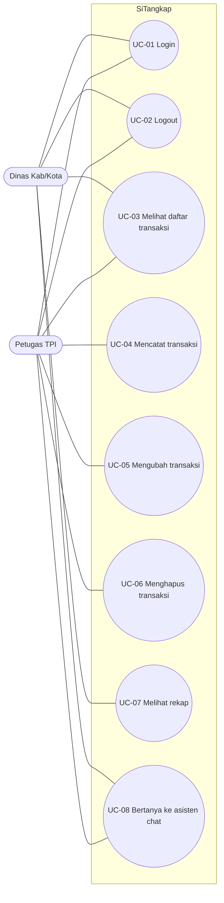
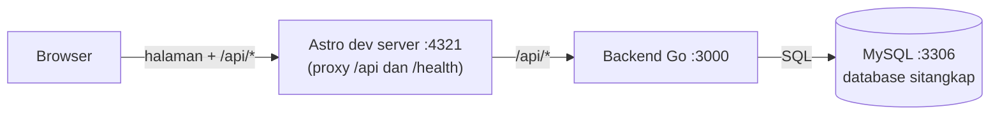

# 00 · Overview Proyek SiTangkap

> **Untuk manusia dan AI agent.** Dokumen ini adalah gambaran besar dan sumber kebenaran untuk *requirement*.
> Detail teknis antarperan ada di [`01-api-contract.md`](01-api-contract.md).
> Kalau ada yang bertentangan, urutan prioritasnya: `01-api-contract.md` > dokumen ini > dokumen peran.

| Item | Nilai |
| --- | --- |
| Nama sistem | SiTangkap |
| Jenis | Aplikasi web pencatatan transaksi lelang ikan di TPI (Tempat Pelelangan Ikan) |
| Fase sekarang | **Development** (jalan di laptop). Deploy ke server = fase 2, lihat [`02-cicd-jenkins.md`](02-cicd-jenkins.md) |
| Target waktu | 2 hari kerja |
| Desain UI | Figma: <https://www.figma.com/design/DhWEhuRCLzcyPLhZuYiavO> |

## 1. Tim dan kepemilikan

| Peran | Nama | Dokumen | Folder yang dimiliki |
| --- | --- | --- | --- |
| Project Manager (PM) | tmthy | [`roles/pm-tmthy.md`](roles/pm-tmthy.md) | `docs/`, `Jenkinsfile`, `deploy/`, `README.md`, `AGENTS.md`, `CLAUDE.md`, `.github/`, `.githooks/`, `.gitignore` |
| Frontend | Magen | [`roles/frontend-magen.md`](roles/frontend-magen.md) | `frontend/` |
| Backend | Rafli | [`roles/backend-rafli.md`](roles/backend-rafli.md) | `backend/` |
| Database | abas | [`roles/database-abas.md`](roles/database-abas.md) | `db/` |

Pengecualian: fitur asisten chat (FR-012, tahap B-13 s.d. B-15, FE-11, FE-12) dikerjakan tmthy di file `backend/` dan `frontend/` yang terdaftar di `AGENTS.md` bagian 1, dengan review dari Rafli (backend) dan Magen (frontend).

Aturan kepemilikan: **hanya pemilik folder yang mengubah isi foldernya.** Kalau butuh perubahan di folder orang lain, buat issue atau minta lewat pull request yang ditinjau pemiliknya. Semua perubahan masuk ke `dev` lewat pull request, dan `dev` dirilis ke `main` oleh PM, lihat [`03-git-workflow.md`](03-git-workflow.md).

## 2. Masalah yang diselesaikan

**Rumusan masalah:**
Dinas kabupaten/kota kesulitan memperoleh dan memeriksa rekap hasil lelang dari TPI di wilayahnya karena transaksi dicatat di karcis dan buku, laporan diserahkan dalam bentuk dokumen fisik, lalu diketik ulang oleh dinas ke komputer, sehingga rekap baru tersedia setelah dokumen tiba dan pencatatan nilai produksi serta retribusi sering tidak teliti.

**Dasar (studi dokumen, tanpa observasi lapangan):**
- Alur lelang TPI dan peran juru catat, kasir, manajer, dinas: peraturan bupati tentang penyelenggaraan TPI.
- Pencatatan manual, laporan fisik, dinas mengetik ulang: skripsi Universitas Muria Kudus (Bab 1).
- Kewenangan kabupaten/kota menyelenggarakan TPI: lampiran UU 23/2014 (lewat artikel jurnal Undip).

Batasan analisis: disusun dari dokumen daring tanpa observasi lapangan; sebagian alur dan angka adalah asumsi.

## 3. Ruang lingkup

| Di dalam sistem | Di luar sistem (alasan) |
| --- | --- |
| Petugas TPI mencatat transaksi lelang yang sudah selesai | Pembayaran bakul dan nelayan (masalah yang dipilih adalah pencatatan dan laporan) |
| Sistem menghitung nilai transaksi dan retribusi otomatis | Tahap sebelum lelang selesai (dicatat sekaligus setelah lelang) |
| Petugas mengubah dan menghapus transaksi | Ikan yang dijual di luar TPI |
| Dinas melihat daftar transaksi dan rekap dengan filter tanggal | Stok dan ikan keluar |
| Login dua peran: `petugas` dan `dinas` | Manajer TPI, persetujuan rekap, riwayat perubahan, admin sistem (pengembangan lanjutan) |
| Satu TPI | Banyak TPI dan perbandingan antar-TPI |
| Asisten chat berbasis aturan yang menjawab pertanyaan tentang data transaksi | Chatbot berbasis model AI (LLM) atau layanan AI luar (butuh API key, biaya, dan data keluar dari server) |
| | Halaman pendaftaran atau kelola akun (akun dibuat lewat SQL) |
| | Nama pemenang (bakul) |

## 4. Aktor

| Aktor | Kode peran (`role`) | Pengguna sistem | Tujuan |
| --- | --- | --- | --- |
| Petugas TPI (juru catat) | `petugas` | Ya, primary actor | Mencatat, mengubah, menghapus transaksi lelang |
| Dinas kabupaten/kota | `dinas` | Ya, primary actor | Memantau transaksi dan melihat rekap |
| Nelayan, bakul, kasir, manajer TPI | — | Tidak | Pemangku kepentingan; nelayan hanya muncul sebagai data |

## 5. Functional requirements (prioritas MoSCoW)

| ID | Requirement | Aktor | Prioritas |
| --- | --- | --- | --- |
| FR-001 | Pengguna dapat login dengan username dan password, lalu diarahkan ke halaman sesuai perannya | Petugas, Dinas | Must |
| FR-002 | Pengguna dapat logout | Petugas, Dinas | Must |
| FR-003 | Pengguna dapat melihat daftar transaksi, diurutkan dari tanggal terbaru | Petugas, Dinas | Must |
| FR-004 | Petugas dapat mencatat transaksi: nama nelayan, jenis ikan, berat (kg), harga lelang per kg, tanggal lelang | Petugas | Must |
| FR-005 | Petugas dapat mengubah transaksi | Petugas | Must |
| FR-006 | Petugas dapat menghapus transaksi setelah konfirmasi | Petugas | Must |
| FR-007 | Sistem menghitung nilai transaksi dan retribusi setiap transaksi secara otomatis | Sistem | Must |
| FR-008 | Dinas dapat melihat rekap (jumlah transaksi, total berat, total nilai, total retribusi) untuk rentang tanggal | Dinas | Must |
| FR-009 | Dinas dapat memfilter daftar transaksi berdasarkan rentang tanggal | Dinas | Must |
| FR-010 | Dinas dapat memilih rentang cepat: Hari ini, Bulan ini, Tahun ini | Dinas | Should |
| FR-011 | Sistem menyediakan endpoint health untuk pemeriksaan otomatis (dipakai Jenkins) | Sistem | Should |
| FR-012 | Pengguna dapat bercakap dengan asisten chat "Si Tangkap" dalam Bahasa Indonesia sehari-hari, termasuk slang, salah ketik, dan pertanyaan lanjutan (misalnya "brp trx hari ini?" lalu "kalau kemarin?"), dan mendapat jawaban berisi angka dari data transaksi | Petugas, Dinas | Could |

**Won't have (versi ini):** persetujuan manajer, riwayat perubahan, banyak TPI, ekspor Excel/PDF, pembayaran, kelola akun lewat aplikasi.

## 6. Non-functional requirements

| ID | Requirement | Prioritas |
| --- | --- | --- |
| NFR-001 | Password disimpan sebagai hash bcrypt (cost 12), tidak pernah teks biasa | Must |
| NFR-002 | Semua query SQL memakai parameter (`?`), tidak pernah menggabungkan string input | Must |
| NFR-003 | Cookie sesi bersifat `HttpOnly`, `SameSite=Lax`, berlaku 8 jam | Must |
| NFR-004 | `go vet`, `go test`, dan `npm run build` harus lulus sebelum merge: pembuat PR menempelkan output-nya di setiap PR ke `dev`, dan Jenkins menjalankannya lagi di setiap rilis ke `main` sebelum deploy | Must |
| NFR-005 | Respons API di bawah 1 detik untuk data sampai 1.000 transaksi di laptop development | Should |
| NFR-006 | Halaman login di bawah 100 KB terkirim (tanpa font atau library dari CDN) | Should |
| NFR-007 | Halaman bisa dipakai di layar lebar 360 px; tabel boleh digeser di dalam kotaknya sendiri | Should |
| NFR-008 | Pesan error di layar memakai Bahasa Indonesia dan tidak menampilkan detail teknis (stack trace, SQL) | Must |

## 7. Business rules

| ID | Aturan |
| --- | --- |
| BR-01 | Hanya peran `petugas` yang boleh menambah, mengubah, dan menghapus transaksi. Peran `dinas` hanya membaca. |
| BR-02 | `berat_kg` lebih dari 0, paling besar 100000, paling banyak 2 angka desimal. |
| BR-03 | `harga_per_kg` bilangan bulat rupiah, lebih dari 0, paling besar 100000000. |
| BR-04 | `tanggal` harus tanggal yang nyata dan tidak boleh setelah hari ini. |
| BR-05 | `nilai = round(berat_kg × harga_per_kg)`; `retribusi = round(nilai × tarif)`. `round` = pembulatan ke rupiah terdekat, setengah dibulatkan menjauhi nol. Tarif dari konfigurasi `RETRIBUSI_TARIF` (default contoh `0.03` = 3%, **harus dikonfirmasi ke perda daerah**). |
| BR-06 | Akun dibuat langsung di database oleh tim database. Tidak ada halaman pendaftaran. |
| BR-07 | Rentang tanggal: `dari` ≤ `sampai`, keduanya inklusif. |
| BR-08 | Hapus transaksi wajib dikonfirmasi di UI dan bersifat permanen. |
| BR-09 | `nama_nelayan` 1 sampai 100 karakter, `jenis_ikan` 1 sampai 60 karakter, setelah spasi di awal dan akhir dibuang. |
| BR-10 | Asisten chat bekerja dengan aturan kata kunci (mirip AIML), tanpa layanan AI luar dan tanpa dependensi baru. Aturan, urutan, kamus slang, percakapan ringan, dan templat jawabannya tertulis di `01-api-contract.md` (`POST /api/chat`). Jawaban bervariasi tetapi deterministik: pertanyaan yang sama selalu mendapat jawaban yang sama. |
| BR-11 | Asisten chat hanya membaca data. Angka di jawaban dihitung dengan aturan yang sama dengan rekap (BR-05), sehingga selalu sama dengan rekap untuk rentang yang sama. |
| BR-12 | Pertanyaan 1 sampai 200 karakter setelah trim. Riwayat percakapan tidak disimpan di server maupun di database, dan isi pertanyaan tidak dicatat ke log. Pertanyaan lanjutan memakai `konteks` yang disimpan frontend di memori halaman dan dikirim bersama setiap pertanyaan. |

## 8. Use case

| ID | Use case | Aktor | Requirement |
| --- | --- | --- | --- |
| UC-01 | Login | Petugas, Dinas | FR-001 |
| UC-02 | Logout | Petugas, Dinas | FR-002 |
| UC-03 | Melihat daftar transaksi | Petugas, Dinas | FR-003, FR-009 |
| UC-04 | Mencatat transaksi | Petugas | FR-004, FR-007 |
| UC-05 | Mengubah transaksi | Petugas | FR-005, FR-007 |
| UC-06 | Menghapus transaksi | Petugas | FR-006 |
| UC-07 | Melihat rekap | Dinas | FR-008, FR-010 |
| UC-08 | Bertanya ke asisten chat | Petugas, Dinas | FR-012 |

## 9. Requirement Traceability Matrix (RTM)

Kolom Test berisi ID tes backend dari [`roles/backend-rafli.md`](roles/backend-rafli.md) dan ID cek manual frontend dari [`roles/frontend-magen.md`](roles/frontend-magen.md).

| Req | Use case | Endpoint | Layar Figma | Test |
| --- | --- | --- | --- | --- |
| FR-001 | UC-01 | `POST /api/login`, `GET /api/me` | 01 Login, 02 Login gagal | T-01, T-02, T-03, F-01, F-02 |
| FR-002 | UC-02 | `POST /api/logout` | Topbar semua layar | T-04, F-03 |
| FR-003 | UC-03 | `GET /api/transaksi` | 10 Petugas, 14 Belum ada data, 20 Dinas | T-05, F-04 |
| FR-004 | UC-04 | `POST /api/transaksi` | 11 Tambah transaksi | T-06, T-07, T-08, F-05 |
| FR-005 | UC-05 | `PUT /api/transaksi/{id}` | 12 Ubah transaksi | T-09, T-10, F-06 |
| FR-006 | UC-06 | `DELETE /api/transaksi/{id}` | 13 Konfirmasi hapus | T-11, F-07 |
| FR-007 | UC-04, UC-05 | (field `nilai`, `retribusi` di respons) | 11, 12, 20 | T-12 |
| FR-008 | UC-07 | `GET /api/rekap` | 20 Dinas, 21 Tidak ada data | T-13, F-08 |
| FR-009 | UC-03 | `GET /api/transaksi?dari=&sampai=` | 20 Dinas | T-14, F-09 |
| FR-010 | UC-07 | (frontend saja) | 20 Dinas | F-10 |
| FR-011 | — | `GET /health` | — | T-15 |
| FR-012 | UC-08 | `POST /api/chat` | 30 Asisten chat (belum dibuat) | T-17 s.d. T-25, F-14 s.d. F-17 |
| BR-10, BR-11, BR-12 | UC-08 | `POST /api/chat` | 30 | T-17 s.d. T-25 |
| BR-01 | UC-04, 05, 06 | semua endpoint tulis | — | T-16 |
| BR-02, BR-09 | UC-04, UC-05 | `POST`/`PUT /api/transaksi` (422) | 11, 12 | T-07, T-08, F-11 |
| NFR-006 | — | — | 01 Login | F-12 |
| NFR-007 | — | — | semua | F-13 |

## 10. Arsitektur

- **Development:** frontend jalan di port 4321 dan meneruskan `/api` serta `/health` ke backend port 3000. Browser hanya melihat satu origin (`localhost:4321`), jadi cookie login berjalan tanpa CORS.
- **Production (fase 2):** backend Go melayani API **dan** file statis hasil build Astro dari satu port, lihat `STATIC_DIR` di kontrak API.
- Port backend sengaja **3000**, bukan 8080, karena Jenkins memakai 8080 di server.

## 11. Stack

| Bagian | Teknologi | Catatan |
| --- | --- | --- |
| Backend | Go 1.26+ | `net/http` standar (pola rute Go 1.22), `database/sql`, `github.com/go-sql-driver/mysql`, `golang.org/x/crypto/bcrypt`. Tidak memakai framework (Gin, Echo, dll.) |
| Frontend | Astro, output statis | JavaScript biasa di sisi klien, CSS sendiri. Tidak memakai React/Vue/Tailwind |
| Database | MySQL 8 (atau MariaDB 10.6+) | Satu database `sitangkap`, dua tabel |
| Versi kode | Git + GitHub | Satu repo, folder `backend/`, `frontend/`, `db/`, `docs/` |
| CI/CD (fase 2) | Jenkins di VPS + webhook GitHub | Tanpa Docker |

## 12. Glosarium

| Istilah | Arti |
| --- | --- |
| TPI | Tempat Pelelangan Ikan |
| Transaksi | Satu kejadian lelang yang sudah selesai: ikan dari seorang nelayan terjual dengan harga tertentu pada tanggal tertentu |
| Nilai transaksi | `berat_kg × harga_per_kg`, dibulatkan ke rupiah |
| Retribusi | Pungutan daerah dari nilai transaksi, `nilai × tarif` |
| Rekap | Jumlah transaksi dan total berat, nilai, retribusi dalam suatu rentang tanggal |
| Petugas | Juru catat di TPI, peran `petugas` |
| Dinas | Dinas perikanan kabupaten/kota, peran `dinas` |
