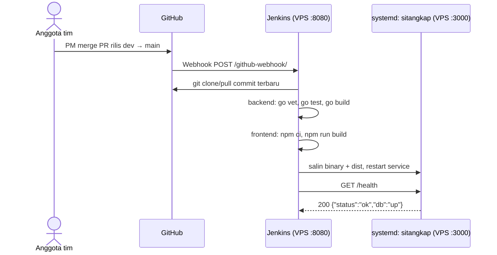

# 02 · CI/CD dengan Jenkins dan Webhook GitHub (Fase 2)

> **Pemilik: tmthy (PM).** Dikerjakan setelah aplikasi lulus UAT di laptop (CP-4).
> Tujuan: setiap rilis ke `main` (merge PR `dev` → `main`) langsung memicu Jenkins di VPS untuk menguji, membangun, dan men-deploy SiTangkap, **tanpa Docker**. Alur branch: [`03-git-workflow.md`](03-git-workflow.md).

## Gambaran alur



| Tahap demo kelas | Bukti di layar |
| --- | --- |
| Create Job Jenkins | Halaman konfigurasi job `sitangkap` |
| Edit kode dan push dari lokal | Terminal `git push` branch tugas → PR ke `dev` → PR rilis `dev` → `main` |
| Git clone/pull otomatis | Build baru muncul beberapa detik setelah push, log "Started by GitHub push" |
| Connect ke database | Stage Smoke test: `/health` → `db: up` |
| CRUD | Aplikasi di `http://IP_VPS:3000` |

## CI-01 · Siapkan VPS

Kebutuhan: Ubuntu 22.04/24.04, RAM **minimal 2 GB** (Jenkins sendiri memakai sekitar 0,5–1 GB), IP publik, akses SSH dengan sudo.

```bash
sudo apt update && sudo apt -y upgrade
sudo apt -y install git curl rsync fontconfig openjdk-21-jre mysql-server
```

**Go** (unduh versi stabil terbaru dari <https://go.dev/dl/>, minimal 1.26 karena `golang.org/x/crypto` terbaru membutuhkannya; contoh di bawah memakai 1.26.x):

```bash
curl -fsSLO https://go.dev/dl/go1.26.10.linux-amd64.tar.gz
sudo rm -rf /usr/local/go && sudo tar -C /usr/local -xzf go1.26.10.linux-amd64.tar.gz
sudo ln -sf /usr/local/go/bin/go /usr/local/bin/go      # agar user jenkins juga menemukan go
go version
```

**Node.js 22** (NodeSource). Astro 7 butuh **22.23.4 atau lebih baru**:

```bash
curl -fsSL https://deb.nodesource.com/setup_22.x | sudo -E bash -
sudo apt -y install nodejs
node -v                     # harus v22.23.4 atau lebih baru
```

**Jenkins:** ikuti perintah resmi terbaru di <https://www.jenkins.io/doc/book/installing/linux/> bagian Debian/Ubuntu (alamat kunci repositori bisa berubah antarversi). Setelah terpasang:

```bash
sudo systemctl enable --now jenkins
sudo cat /var/lib/jenkins/secrets/initialAdminPassword
```

Buka `http://IP_VPS:8080`, pilih **Install suggested plugins** (sudah termasuk plugin Git dan GitHub), buat akun admin dengan password kuat.

**Firewall** (ufw dan juga security group di penyedia cloud):

```bash
sudo ufw allow OpenSSH
sudo ufw allow 8080/tcp     # Jenkins, perlu terbuka agar webhook GitHub bisa masuk
sudo ufw allow 3000/tcp     # aplikasi SiTangkap
sudo ufw enable
```

Port MySQL 3306 **jangan** dibuka ke internet.

## CI-02 · Database production

```bash
git clone https://github.com/tmthyjw23/SiTangkap.git /tmp/sitangkap-setup
sudo mysql < /tmp/sitangkap-setup/db/schema.sql
sudo mysql sitangkap < /tmp/sitangkap-setup/db/seed.sql     # opsional: data demo untuk presentasi
```

**Wajib bila seed dijalankan:** password akun demo (`petugas123`, `dinas123`) tertulis di repo public, dan aplikasi terbuka di IP publik. Ganti keduanya **sebelum** port 3000 dibuka. Buat hash bcrypt cost 12 untuk password baru (huruf dan angka saja), lalu simpan ke database:

```bash
sudo apt -y install apache2-utils
HASH_PETUGAS=$(htpasswd -nbBC 12 "" 'GANTI_PASSWORD_PETUGAS' | tr -d ':\n')
HASH_DINAS=$(htpasswd -nbBC 12 "" 'GANTI_PASSWORD_DINAS' | tr -d ':\n')
sudo mysql sitangkap -e "UPDATE users SET password_hash = '$HASH_PETUGAS' WHERE username = 'petugas01';
UPDATE users SET password_hash = '$HASH_DINAS' WHERE username = 'dinas01';"
history -c                  # hapus password dari riwayat shell
```

Hash dari `htpasswd` berawalan `$2y$`; library bcrypt Go menerimanya. Cek: login dengan password lama harus gagal `401`, password baru berhasil. Kalau seed dijalankan ulang di server, ulangi langkah ini.

Buat user aplikasi dengan **password kuat yang berbeda** dari `sitangkap_dev`, terdiri dari huruf dan angka saja supaya aman di file `.env` (jangan pakai `db/app_user.sql` apa adanya):

```bash
sudo mysql -e "CREATE USER 'sitangkap_app'@'localhost' IDENTIFIED BY 'GANTI_PASSWORD_KUAT';
CREATE USER 'sitangkap_app'@'127.0.0.1' IDENTIFIED BY 'GANTI_PASSWORD_KUAT';
GRANT SELECT, INSERT, UPDATE, DELETE ON sitangkap.* TO 'sitangkap_app'@'localhost';
GRANT SELECT, INSERT, UPDATE, DELETE ON sitangkap.* TO 'sitangkap_app'@'127.0.0.1';
FLUSH PRIVILEGES;"
```

## CI-03 · Folder aplikasi, `.env`, dan service systemd

```bash
sudo useradd --system --no-create-home --shell /usr/sbin/nologin sitangkap
sudo mkdir -p /opt/sitangkap/bin /opt/sitangkap/frontend /opt/sitangkap/prev
sudo chown -R jenkins:jenkins /opt/sitangkap/bin /opt/sitangkap/frontend /opt/sitangkap/prev

sudo tee /opt/sitangkap/.env > /dev/null <<'EOF'
PORT=3000
DB_HOST=127.0.0.1
DB_PORT=3306
DB_USER=sitangkap_app
DB_PASSWORD=GANTI_PASSWORD_KUAT
DB_NAME=sitangkap
RETRIBUSI_TARIF=0.03
APP_TIMEZONE=Asia/Makassar
SESSION_TTL_HOURS=8
COOKIE_SECURE=false
STATIC_DIR=/opt/sitangkap/frontend
EOF
sudo chown root:sitangkap /opt/sitangkap/.env
sudo chmod 640 /opt/sitangkap/.env
```

Pasang service dari repo (`deploy/sitangkap.service`):

```bash
sudo cp /tmp/sitangkap-setup/deploy/sitangkap.service /etc/systemd/system/sitangkap.service
sudo systemctl daemon-reload
sudo systemctl enable sitangkap        # dijalankan pertama kali oleh Jenkins setelah binary ada
```

Izinkan user `jenkins` me-restart service tanpa password, **hanya** untuk perintah ini (`deploy/sudoers-jenkins`):

```bash
sudo cp /tmp/sitangkap-setup/deploy/sudoers-jenkins /etc/sudoers.d/sitangkap-jenkins
sudo chmod 440 /etc/sudoers.d/sitangkap-jenkins
sudo visudo -c                          # wajib "parsed OK"
```

## CI-04 · Buat job Jenkins

1. Dashboard → **New Item** → nama `sitangkap` → **Pipeline** → OK.
2. **General:** centang **GitHub project**, isi URL repo (`https://github.com/tmthyjw23/SiTangkap/`).
3. **Triggers:** centang **GitHub hook trigger for GITScm polling**.
4. **Pipeline:** Definition **Pipeline script from SCM** → SCM **Git** → Repository URL repo kalian.
   - Repo private: **Add credentials** → jenis *Username with password* → username GitHub dan **Personal Access Token** (fine-grained, akses *Contents: Read-only* ke repo ini) sebagai password.
   - Branch Specifier: `*/main`. Script Path: `Jenkinsfile`.
   - Job ini hanya membangun `main`. Merge ke `dev` juga mengirim webhook, tetapi Jenkins tidak membangun apa pun karena `main` tidak berubah. Deploy terjadi saat PM me-merge PR rilis `dev` → `main`.
5. Save → **Build Now** sekali. Build pertama ini juga mendaftarkan trigger webhook dari `Jenkinsfile`.

## CI-05 · Pasang webhook di GitHub

Repo → **Settings → Webhooks → Add webhook**:

| Isian | Nilai |
| --- | --- |
| Payload URL | `http://IP_VPS:8080/github-webhook/` (**garis miring di akhir wajib**) |
| Content type | `application/json` |
| Secret | **Wajib.** Port 8080 terbuka ke internet, jadi tanpa secret siapa pun bisa mengirim webhook palsu ke Jenkins. Buat dengan `openssl rand -hex 32`, lalu masukkan nilai yang sama di Jenkins: Manage Jenkins → System → bagian GitHub → Advanced → shared secret (letak menu bisa sedikit berbeda antarversi plugin). Jangan simpan nilainya di repo |
| Events | **Just the push event** |
| Active | Centang |

Uji: di halaman webhook, tab **Recent Deliveries** harus menampilkan respons `200`. Lalu merge satu PR rilis kecil `dev` → `main`; dalam beberapa detik build baru muncul dengan keterangan "Started by GitHub push by ...".

## CI-06 · `Jenkinsfile`

File ada di root repo. Ringkasan stage:

| Stage | Perintah | Gagal bila |
| --- | --- | --- |
| Checkout | `checkout scm` + cetak commit | Repo tidak bisa diambil |
| Uji & build (paralel) | Backend: `go vet`, `go test`, `go build`. Frontend: `npm ci`, `npm run build` | Ada tes gagal atau build error |
| Deploy | Simpan versi yang sedang jalan ke `/opt/sitangkap/prev`, salin binary dan `frontend/dist`, `systemctl restart sitangkap`. Job hanya membangun `*/main` (CI-04), jadi tidak perlu kondisi branch | Izin folder/sudo salah |
| Smoke test | `curl /health` sampai 15 kali. Gagal: kembalikan versi dari `/opt/sitangkap/prev` dan restart (rollback otomatis) | Aplikasi tidak hidup atau database tidak terjangkau |

Demo "CI menangkap kesalahan": ubah satu angka di tabel tes T-12 lewat branch tugas, merge ke `dev`, lalu rilis ke `main`. Build berhenti merah di stage Backend, **tidak ada deploy**, aplikasi di server tetap versi lama. Kembalikan, push lagi, build hijau.

## Masalah umum

| Gejala | Penyebab dan solusi |
| --- | --- |
| Recent Deliveries di GitHub gagal / timeout | Port 8080 tertutup (ufw atau security group cloud), atau Payload URL tanpa `/` di akhir |
| Webhook 200 tapi build tidak jalan | Checkbox "GitHub hook trigger for GITScm polling" belum dicentang, atau belum pernah **Build Now** sekali |
| `go: command not found` | Symlink `/usr/local/bin/go` belum dibuat (CI-01) |
| `npm ci` gagal: no package-lock.json | Frontend belum commit `frontend/package-lock.json` |
| `sudo: a password is required` | File sudoers belum terpasang atau path `systemctl` berbeda (`which systemctl`) |
| Smoke test gagal, `db: down` | Isi `/opt/sitangkap/.env` (password DB) salah; cek `sudo journalctl -u sitangkap -n 50` |
| `text file busy` saat menyalin binary | Pakai langkah salin ke `.new` lalu `mv` seperti di `Jenkinsfile` |
| Log "Rollback ke versi sebelumnya" | Versi baru gagal smoke test dan versi lama sudah dipulihkan. Cari penyebabnya di log `journalctl` yang dicetak sebelum rollback. Di deploy pertama belum ada versi lama, jadi rollback dilewati |
| `npm ci`/`npm run build`: `Node.js ... is not supported by Astro` | Node di VPS lebih lama dari 22.23.4. Ulangi pemasangan Node di CI-01 |
| Halaman `/petugas` 404 di server | `STATIC_DIR` tidak menunjuk ke `/opt/sitangkap/frontend` atau stage frontend tidak menyalin `dist` |

## Batasan yang perlu disebut di laporan

- Aplikasi diakses lewat HTTP biasa di port 3000. Untuk penggunaan nyata perlu HTTPS (Nginx + sertifikat) dan `COOKIE_SECURE=true`.
- Sesi disimpan di memori: setiap deploy (restart) membuat pengguna harus login ulang.
- Jenkins dan aplikasi berada di satu VPS demi kesederhanaan; di production biasanya dipisah.
