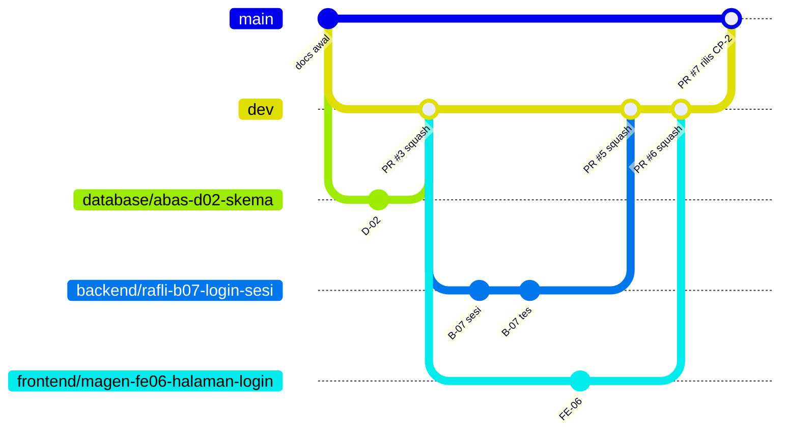

# 03 · Alur Kerja Git dan Pull Request

> **Untuk semua anggota dan AI agent.** Wajib dibaca sebelum commit pertama.
> Aturan paling penting: **`main` hanya berubah lewat pull request (PR) rilis dari `dev` oleh PM.** Push langsung ke `dev` diizinkan (tanpa PR dan tanpa approval). Branch tugas + PR ke `dev` tetap boleh dipakai bila ingin ditinjau dulu.

## 0. Enam aturan emas

1. Push langsung ke `main` atau `master` **dilarang**; GitHub dan pengaman di laptop akan menolaknya. Push langsung ke `dev` **boleh**: jalankan `git pull origin dev` dulu, lalu perintah verifikasi peranmu, baru `git push origin dev`.
2. Bila memakai branch tugas, buat **dari `dev`** dan PR-nya ditujukan **ke `dev`**.
3. Satu tugas (satu ID: `B-07`, `FE-06`, `D-04`, ...) = satu branch = satu PR.
4. Ubah hanya folder milik peranmu (lihat `AGENTS.md`).
5. Sebelum push: perintah verifikasi peranmu harus lulus.
6. Jangan pernah `git push --force`.

## 1. Struktur branch



| Branch | Fungsi | Masuk lewat | Siapa yang merge |
| --- | --- | --- | --- |
| `main` | Versi rilis yang stabil. Jenkins men-deploy dari sini (fase 2) | PR **rilis** dari `dev` | PM, dengan **Create a merge commit** |
| `dev` | Tempat semua pekerjaan digabung dan diuji bersama. Selalu harus bisa dijalankan. **Default branch** repo | PR dari branch tugas | PM, dengan **Squash and merge** |
| `<peran>/<nama>-<id>-<ringkasan>` | Satu tugas. Dibuat dari `dev`, dihapus setelah di-merge | Commit pemiliknya | — |

Kenapa metode merge-nya berbeda: squash membuat riwayat `dev` rapi (satu commit per tugas). Tapi kalau PR `dev` → `main` juga di-squash, `main` dan `dev` tidak lagi berbagi riwayat. PR rilis berikutnya akan menampilkan ulang commit lama dan memicu konflik palsu. Merge commit biasa menghindari masalah itu.

### Format nama branch tugas

```text
<peran>/<nama>-<id-tugas>-<ringkasan>
```

| Bagian | Isi yang boleh |
| --- | --- |
| `<peran>` | `frontend`, `backend`, `database`, `docs`, `ci` |
| `<nama>` | `magen`, `rafli`, `abas`, `tmthy` |
| `<id-tugas>` | ID tugas huruf kecil tanpa tanda hubung: `fe06`, `b07`, `d04`, `ci03` |
| `<ringkasan>` | 1–4 kata, huruf kecil, dipisah tanda hubung |

| Orang | Contoh branch |
| --- | --- |
| Magen | `frontend/magen-fe06-halaman-login`, `frontend/magen-fe07-halaman-petugas` |
| Rafli | `backend/rafli-b07-login-sesi`, `backend/rafli-b10-tes` |
| abas | `database/abas-d02-skema`, `database/abas-d05-queries` |
| tmthy | `docs/tmthy-ubah-kontrak-rekap`, `ci/tmthy-ci04-jenkinsfile` |

Yang **tidak boleh**:
- Spasi dan tanda kurung, misalnya `FrontEnd/(Magen - login)`. Git menolak spasi, dan tanda kurung harus dikutip di terminal.
- Huruf besar, misalnya `FrontEnd/...`. Windows dan macOS tidak membedakan besar-kecil, sehingga `FrontEnd/x` dan `frontend/x` bisa bertabrakan.
- Satu branch abadi per orang (misal `magen` yang dipakai terus). Branch seperti itu cepat tertinggal jauh dari `dev` dan konfliknya menumpuk.

## 2. Persiapan sekali per anggota

```bash
# 1. Identitas (email = email akun GitHub, supaya commit tertaut ke akunmu)
git config --global user.name "Nama Kamu"
git config --global user.email "email-github-kamu@contoh.com"
git config --global init.defaultBranch main

# 2. Clone repo (otomatis berada di branch dev, karena dev adalah default branch)
git clone https://github.com/tmthyjw23/SiTangkap.git sitangkap
cd sitangkap

# 3. Pasang pengaman lokal yang menolak push ke main/master (WAJIB)
git config core.hooksPath .githooks

# 4. Cek
git config core.hooksPath      # harus menampilkan: .githooks
git branch --show-current      # harus: dev
```

Login GitHub saat push pertama: Git for Windows dan GitHub Desktop memunculkan jendela login browser (Git Credential Manager). Di Linux/macOS, pakai `gh auth login` dari GitHub CLI atau Personal Access Token sebagai password.

## 3. Alur satu tugas, langkah demi langkah

Contoh di bawah memakai Rafli mengerjakan `B-07`. Ganti nama, peran, dan ID sesuai tugasmu.

### Langkah 1 · Ambil issue

Buka tab **Issues**, pilih issue tugasmu (misal "B-07 Login, logout, me, sesi"), lalu klik **Assignees → assign yourself**. Catat nomornya, misalnya `#12`.

### Langkah 2 · Mulai dari `dev` terbaru

```bash
git switch dev
git pull origin dev
git status                     # harus: "nothing to commit, working tree clean"
```

Kalau `git status` tidak bersih, selesaikan atau simpan dulu pekerjaan sebelumnya. Jangan membawa perubahan lama ke branch baru.

### Langkah 3 · Buat branch tugas dari `dev`

```bash
git switch -c backend/rafli-b07-login-sesi
git branch --show-current      # harus: backend/rafli-b07-login-sesi
```

### Langkah 4 · Kerjakan dan commit kecil-kecil

```bash
git status                     # lihat file apa saja yang berubah
git diff                       # baca perubahannya
git add backend/               # tambahkan HANYA folder milikmu, bukan "git add ." membabi buta
git diff --staged              # periksa lagi yang akan di-commit
git commit -m "feat(backend): B-07 sesi di memori dan cookie"
```

Commit sesering perlu. Semua commit di branch ini nanti digabung menjadi satu commit saat merge ke `dev` (squash).

**Format pesan commit:**

```text
<jenis>(<peran>): <ID> <ringkasan dalam Bahasa Indonesia>
```

| Jenis | Kapan | Contoh |
| --- | --- | --- |
| `feat` | Fitur baru | `feat(frontend): FE-06 halaman login dan pesan error` |
| `fix` | Perbaikan bug | `fix(backend): B-09 PUT mengembalikan 404 untuk id tidak ada` |
| `test` | Menambah atau mengubah tes | `test(backend): B-10 tes T-13 rekap` |
| `docs` | Dokumen | `docs(pm): perbarui kontrak meta tarif_retribusi` |

`<peran>` di pesan commit hanya boleh salah satu dari: `frontend`, `backend`, `database`, `pm`. Bukan `db`, `fe`, atau `be`. Perhatikan bahwa ini berbeda dari awalan nama branch: perubahan PM memakai branch `docs/...` atau `ci/...`, tetapi pesan commit-nya tetap `(pm)`.
| `chore` | Konfigurasi, dependensi, rapi-rapi | `chore(frontend): FE-01 inisialisasi proyek Astro` |

**Apa yang boleh di-commit:**

| Commit ✅ | Jangan commit ❌ (sudah di `.gitignore`) |
| --- | --- |
| Kode: `backend/*.go`, `frontend/src/**`, `db/*.sql` | `.env` (password, konfigurasi lokal) |
| `go.mod`, `go.sum`, `package.json`, `package-lock.json` | `node_modules/` |
| `backend/.env.example`, `frontend/.env.example` | `frontend/dist/`, `frontend/.astro/`, `backend/sitangkap(.exe)` |
| Dokumen dan konfigurasi repo milik peranmu | `cookie.txt`, `dinas.txt`, `*.log` |
| `db/seed.sql` (data demo) | Dump data asli, password production, token |
| | `.vscode/`, `.idea/`, `.DS_Store` |

Kalau file dari kolom kanan muncul di `git status`, jangan di-`add`, dan beri tahu PM.

### Langkah 5 · Jalankan verifikasi peranmu

| Peran | Perintah | Harus |
| --- | --- | --- |
| Backend | `cd backend && go vet ./... && go test ./...` | Tidak ada error, semua `ok` |
| Frontend | `cd frontend && npm run build` | Build selesai tanpa error |
| Database | `schema.sql` dua kali, `app_user.sql`, `seed.sql`, `verify.sql` (lihat `AGENTS.md`) | Hasil `verify.sql` sesuai dokumen |
| PM (docs) | Buka file Markdown di GitHub preview atau editor | Tautan dan tabel tampil benar |

Simpan output-nya; nanti ditempel di deskripsi PR.

### Langkah 6 · Samakan dengan `dev` terbaru

Anggota lain mungkin sudah merge sesuatu ke `dev` sejak kamu mulai. Gabungkan perubahan mereka **sebelum** push:

```bash
git fetch origin
git merge origin/dev
```

- Tidak ada konflik: lanjut ke langkah 7.
- Ada konflik: lihat bagian 6. Setelah selesai, **jalankan lagi langkah 5**.

Kita memakai `merge`, bukan `rebase`, supaya tidak pernah perlu `push --force`.

### Langkah 7 · Push branch tugas

```bash
git push -u origin backend/rafli-b07-login-sesi
```

`-u` hanya perlu sekali. Push berikutnya di branch yang sama cukup `git push`.

Kalau muncul pesan `DITOLAK: dilarang push langsung ke main`, berarti kamu sedang di branch yang salah. Itu pengaman yang bekerja; ikuti bagian 7.

**Alternatif tanpa PR:** untuk perubahan yang tidak perlu ditinjau, kerjakan langsung di `dev`, lalu `git pull origin dev`, jalankan verifikasi, dan `git push origin dev`. Langkah 8–10 dilewati.

### Langkah 8 · Buat pull request ke `dev`

**Lewat website GitHub:**

1. Buka repo. Muncul banner kuning "**backend/rafli-b07-login-sesi** had recent pushes" → klik **Compare & pull request**. (Atau tab **Pull requests → New pull request**.)
2. Pastikan **base: `dev`** ← **compare: branch-mu**. Karena `dev` adalah default branch, ini biasanya sudah terisi otomatis. **Jangan pernah memilih base `main`.**
3. **Judul:** sama dengan format commit, misalnya `feat(backend): B-07 login, logout, me, dan sesi`.
4. **Deskripsi:** template otomatis muncul. Isi semua bagiannya, termasuk:
   - `Closes #12`;
   - output verifikasi dari langkah 5.
5. Panel kanan:
   - **Reviewers:** `tmthy`. Untuk PR milik tmthy sendiri: pilih salah satu anggota lain.
   - **Assignees:** dirimu.
   - **Labels:** label peranmu (`backend`, `frontend`, `database`, `kontrak`, `ci`).
6. Klik **Create pull request**. Kalau pekerjaan belum selesai tapi ingin minta masukan lebih awal, pilih panah di samping tombol → **Create draft pull request**.

Catatan: kata kunci `Closes #12` hanya menutup issue otomatis saat PR di-merge ke **default branch**. Karena default branch kita `dev`, issue tertutup saat PR tugas di-merge ke `dev`.

**Lewat terminal (GitHub CLI), opsional:**

```bash
gh pr create --base dev --title "feat(backend): B-07 login, logout, me, dan sesi" \
  --body-file .github/pull_request_template.md --reviewer tmthyjw23 --label backend
```

Lalu edit deskripsinya di website untuk mengisi template.

### Langkah 9 · Review dan perbaikan

Peninjau (biasanya tmthy) memakai checklist di `docs/roles/pm-tmthy.md` bagian "Meninjau pull request", lalu memilih **Approve** atau **Request changes**.

Kalau diminta perubahan:

```bash
# masih di branch yang sama
git add backend/
git commit -m "fix(backend): B-07 pesan error login sesuai kontrak"
git push
```

PR otomatis ter-update. Balas setiap komentar ("sudah diperbaiki di commit abc123"), lalu klik **Resolve conversation**. Approval lama otomatis gugur saat ada commit baru, jadi minta peninjau melihat ulang.

### Langkah 10 · Merge ke `dev` (dilakukan PM)

Syarat merge: minimal 1 approval, semua percakapan resolved, tidak ada konflik.

1. PM memilih **Squash and merge** (bukan merge commit).
2. Judul commit squash = judul PR.
3. **Confirm squash and merge**. Branch tugas dihapus otomatis di GitHub.

Kalau GitHub menampilkan "This branch is out-of-date with the base branch", pemilik branch mengulang langkah 6 dan 7, atau menekan tombol **Update branch** di halaman PR.

### Langkah 11 · Bersihkan dan lanjut

```bash
git switch dev
git pull origin dev
git branch -d backend/rafli-b07-login-sesi      # hapus branch lokal yang sudah di-merge
```

Lanjut ke tugas berikutnya dari langkah 1.

## 4. Rilis: `dev` → `main` (khusus PM)

Rilis dilakukan di checkpoint (CP-2, CP-3, CP-4) atau sebelum demo. Di fase 2, setiap rilis ke `main` memicu deploy oleh Jenkins.

1. Pastikan `dev` lulus UAT (`docs/roles/pm-tmthy.md`) dari clone yang baru.
2. **Pull requests → New pull request**, base **`main`** ← compare **`dev`**.
3. Judul: `release: CP-2 login dan daftar transaksi` (sebutkan checkpoint dan isi utamanya).
4. Deskripsi: daftar PR tugas yang ikut (`#5`, `#6`, ...) dan hasil UAT.
5. Minta 1 anggota lain me-review (PM tidak bisa meng-approve PR-nya sendiri).
6. Merge dengan **Create a merge commit**. **Jangan** squash, dan **jangan** klik "Delete branch" setelahnya.

Setelah rilis, `dev` tidak perlu diubah apa pun; pekerjaan berikutnya lanjut di `dev` seperti biasa.

Kalau suatu saat `main` berubah tanpa lewat `dev` (seharusnya tidak pernah terjadi), PM membuat PR `main` → `dev` dengan merge commit supaya keduanya kembali sejalan.

## 5. Kapan membuat PR

| Situasi | Tindakan |
| --- | --- |
| Tugas selesai dan verifikasi lulus | PR biasa ke `dev` |
| Butuh masukan sebelum selesai | Draft PR ke `dev` |
| Checkpoint (CP-1..CP-4) sudah dekat | PR sekarang, walaupun kecil. PR kecil lebih cepat ditinjau |
| PR sudah lebih dari ~400 baris berubah (di luar `package-lock.json`/`go.sum`) | Pecah menjadi beberapa tugas atau PR |
| Butuh perubahan kontrak API | **Bukan** PR kode. Buat issue berlabel `kontrak`; PM membuat PR `docs/...` ke `dev` dulu |

## 6. Mengatasi konflik

Karena setiap peran punya folder sendiri, konflik seharusnya jarang. Kalau terjadi saat `git merge origin/dev`:

```bash
git status                                   # file konflik ditandai "both modified"
```

Buka file itu. Bagian konflik terlihat seperti ini:

```text
<<<<<<< HEAD
versi di branch-mu
=======
versi dari dev
>>>>>>> origin/dev
```

1. Pilih atau gabungkan isinya, lalu hapus ketiga baris penanda (`<<<<<<<`, `=======`, `>>>>>>>`).
2. Simpan, lalu:

```bash
git add <file-yang-konflik>
git commit                                   # pesan merge otomatis; simpan dan keluar
```

3. Jalankan ulang verifikasi (langkah 5), lalu `git push`.

Kalau konflik ada di folder milik orang lain atau di `docs/`, **jangan dipilih sendiri**. Hentikan dengan `git merge --abort`, lalu tanya pemilik folder atau PM.

## 7. Penyelamatan: terlanjur commit di `dev` atau `main` lokal

Gejala: `git branch --show-current` menunjukkan `dev` (atau `main`), kamu sudah commit, dan push ditolak. Contoh untuk `dev`:

```bash
# 1. Pindahkan commit-mu ke branch tugas baru (commit ikut terbawa)
git switch -c backend/rafli-b07-login-sesi

# 2. Kembalikan dev lokal agar sama dengan GitHub
git switch dev
git reset --hard origin/dev

# 3. Lanjutkan di branch tugas
git switch backend/rafli-b07-login-sesi
git push -u origin backend/rafli-b07-login-sesi
```

Untuk `main`, ganti `dev` dengan `main` di langkah 2. Lalu buat PR ke **`dev`**, bukan ke `main`.

`git reset --hard` menghapus perubahan yang **belum di-commit**. Pastikan `git status` bersih setelah langkah 1 sebelum menjalankannya. Kalau ragu, berhenti dan tanya PM. Jangan mencoba `--force`.

## 8. Daftar larangan

| Dilarang | Alasan |
| --- | --- |
| Push langsung ke `main` atau `master` | Melewati PR rilis; GitHub dan hook lokal menolaknya. Push langsung ke `dev` diizinkan |
| PR tugas dengan base `main` | Melewati `dev` dan uji bersama; tutup PR itu dan buat ulang dengan base `dev` |
| `git push --force` ke branch mana pun yang punya PR | Menghapus riwayat dan komentar review |
| Approve atau merge PR milik sendiri | Harus ada mata kedua |
| Squash saat rilis `dev` → `main` | Membuat riwayat `dev` dan `main` berpisah (lihat bagian 1) |
| Menghapus branch `dev` | Branch permanen; dilindungi proteksi branch |
| Commit `.env`, password, token | Bocor permanen. Kalau terlanjur: lapor PM, **ganti password-nya**, baru bersihkan |
| Commit `node_modules/`, `dist/`, binary | Repo membengkak; semuanya bisa dibangun ulang |
| Mengubah folder milik orang lain | Lihat `AGENTS.md` |
| `git add .` tanpa membaca `git status` | Sumber utama file yang tidak sengaja ikut ter-commit |
| Satu PR untuk banyak tugas | Sulit ditinjau dan sulit di-revert |

## 9. Aturan khusus untuk AI agent

1. Sebelum mengubah file, jalankan `git branch --show-current`. Kalau hasilnya `main` atau `master`, **berhenti** dan minta pengguna pindah ke `dev` atau branch tugas. Bekerja langsung di `dev` boleh.
2. Branch tugas selalu dibuat dari `dev` terbaru, dan PR selalu ber-base `dev`.
3. Jangan pernah menjalankan `git push` ke `main`/`master`, `git push --force`, `git reset --hard`, `git rebase`, atau `git branch -D` tanpa izin eksplisit pengguna di pesan yang sama. `git push origin dev` hanya bila pengguna memintanya.
4. Gunakan `git add <folder-peran>/`, bukan `git add .` atau `git add -A`.
5. Tampilkan `git status` dan `git diff --staged` kepada pengguna sebelum `git commit`.
6. Pesan commit mengikuti format di langkah 4.
7. Agent tidak membuat, meng-approve, atau me-merge PR kecuali pengguna memintanya secara eksplisit. Agent **tidak pernah** membuat PR rilis `dev` → `main`.

## 10. Pengaturan repo GitHub (dikerjakan PM sekali)

### 10.1 Batasan paket GitHub

Menurut [dokumentasi GitHub](https://docs.github.com/en/repositories/configuring-branches-and-merges-in-your-repository/managing-protected-branches/about-protected-branches), protected branch tersedia di repo **public** untuk akun gratis, dan di repo **public maupun private** untuk GitHub Pro, Team, dan Enterprise.

- Repo **public**: semua pengaturan di bawah bisa langsung dipakai.
- Repo **private**: akun pemilik repo perlu GitHub Pro. Mahasiswa bisa mendapatkannya gratis lewat GitHub Student Developer Pack (verifikasi status mahasiswa diperlukan).
- Kalau keduanya tidak memungkinkan: pengaman hanya hook lokal (10.5) dan disiplin tim. Hook lokal bisa dilewati, jadi ini jauh lebih lemah.

### 10.2 Membuat branch `dev` (sebelum proteksi diaktifkan)

Setelah commit awal dokumen di `main` (P-03 di panduan PM):

```bash
git switch -c dev
git push -u origin dev
```

### 10.3 Settings → General

- **Default branch:** ubah ke **`dev`** (ikon panah ganda di samping nama branch → pilih `dev` → Update). Akibatnya: clone baru otomatis di `dev`, PR baru otomatis ber-base `dev`, dan `Closes #n` bekerja saat merge ke `dev`.
- **Pull Requests:**
  - [ ] **Allow merge commits**: centang (untuk rilis `dev` → `main`)
  - [ ] **Allow squash merging**: centang (untuk PR tugas → `dev`). Default commit message: "Pull request title"
  - [ ] **Allow rebase merging**: kosongkan
  - [ ] **Always suggest updating pull request branches**: centang
  - [ ] **Automatically delete head branches**: centang. Branch `dev` tidak ikut terhapus karena ia default branch dan dilindungi; tetap jangan klik "Delete branch" manual setelah rilis.

Kalau tersedia di UI-mu, ruleset per branch bisa membatasi metode merge: `dev` hanya squash, `main` hanya merge commit. Kalau tidak tersedia, PM memilih metodenya secara manual sesuai tabel di bagian 1.

### 10.4 Settings → Branches → Add branch protection rule (lakukan dua kali: `main` dan `dev`)

Untuk **`dev`**: hanya **Do not allow bypassing the above settings**, dengan **Allow force pushes** dan **Allow deletions** tidak dicentang. **Jangan** centang "Require a pull request before merging", supaya push langsung ke `dev` bisa.

Untuk **`main`**:

- [ ] **Require a pull request before merging** (di beberapa versi tertulis "Require pull request reviews before merging")
  - [ ] Required approvals: **1**
  - [ ] **Dismiss stale pull request approvals when new commits are pushed**
- [ ] **Require conversation resolution before merging**
- [ ] **Do not allow bypassing the above settings**. Tanpa ini, admin (tmthy) masih bisa push langsung.
- [ ] Biarkan **Allow force pushes** dan **Allow deletions** tidak dicentang (GitHub memblokir keduanya secara default pada protected branch)
- [ ] (Fase 2, opsional, hanya `main`) **Require status checks to pass**, setelah Jenkins dikonfigurasi melaporkan status ke GitHub

Uji, dengan hook dimatikan sementara supaya yang menolak benar-benar GitHub:

```bash
git -c core.hooksPath=/dev/null push origin main    # harus ditolak: "protected branch"
git -c core.hooksPath=/dev/null push --force origin dev   # harus ditolak (force push); push biasa ke dev diterima
```

### 10.5 File pendukung di repo

| File | Fungsi |
| --- | --- |
| `.githooks/pre-push` | Menolak push ke `main`/`master` dari laptop, sebelum sampai ke GitHub. Aktif setelah `git config core.hooksPath .githooks` (bagian 2) |
| `.github/pull_request_template.md` | Template deskripsi PR |
| `.github/CODEOWNERS` | Otomatis meminta review PM di setiap PR. Sudah berisi `@tmthyjw23`. Untuk repo private, fitur ini juga perlu GitHub Pro |

Saat commit `.githooks/pre-push` pertama kali, pastikan file itu bisa dieksekusi di Linux/macOS:

```bash
git add .githooks/pre-push
git update-index --chmod=+x .githooks/pre-push
```

> Catatan: commit awal berisi dokumen (P-03 di panduan PM) dan pembuatan `dev` (10.2) adalah **satu-satunya** push langsung, dan dilakukan **sebelum** proteksi diaktifkan. Setelah 10.4 aktif, perubahan ke `main` wajib lewat PR rilis; push ke `dev` tetap boleh langsung.
