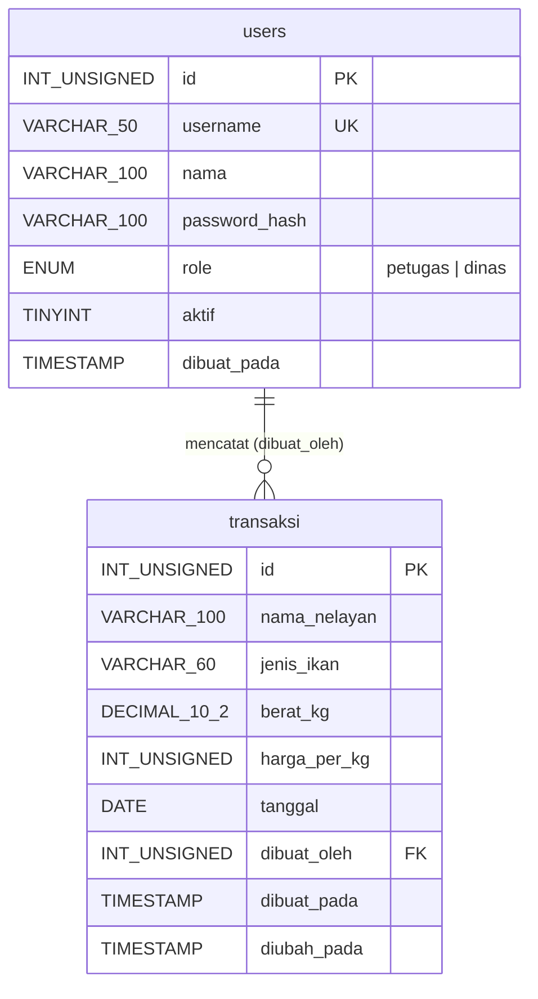

# Panduan Peran: Database (abas)

> **Untuk abas dan AI agent yang membantu abas.**
> Baca dulu: [`../00-overview.md`](../00-overview.md) (bagian 5–7) dan [`../01-api-contract.md`](../01-api-contract.md) (bagian 2 dan 5).
> Kalau ada yang bertentangan, `01-api-contract.md` yang benar.

## Ringkasan peran

| Hal | Isi |
| --- | --- |
| Tanggung jawab | Skema MySQL, data contoh, user database aplikasi, referensi query untuk backend, verifikasi data |
| Folder yang kamu miliki | `db/` |
| Jangan ubah | `backend/`, `frontend/`, `docs/` (minta lewat issue) |
| Kamu memberi ke | **Backend (Rafli):** `db/schema.sql`, `db/seed.sql`, `db/queries.md`, kredensial dev. **Semua anggota:** cara menyiapkan database lokal |
| Kamu menerima dari | **PM:** keputusan tarif retribusi dan akun demo. **Backend:** laporan bila query tidak sesuai |
| Tenggat | Tahap D-01 sampai D-06 selesai **paling lambat tengah hari pertama** (checkpoint CP-1), karena backend menunggu `queries.md` (D-05). D-07 boleh menyusul |

## Hasil akhir (deliverables)

```text
db/
  schema.sql        D-02  database, tabel, constraint, indeks
  app_user.sql      D-03  user aplikasi khusus development
  seed.sql          D-04  akun demo + transaksi contoh (MENGHAPUS data lama)
  queries.md        D-05  query resmi yang dipakai backend
  verify.sql        D-06  query pemeriksaan
  README.md         D-07  cara menyiapkan database lokal untuk anggota tim
```

## D-01 · Pasang MySQL di laptop

Pakai **MySQL 8.0.16+** atau **MariaDB 10.6+** (keduanya menjalankan `CHECK` constraint). Semua anggota tim memasang database di laptop masing-masing; tidak ada database bersama saat development.

Cek:

```bash
mysql --version
mysql -u root -p -e "SELECT VERSION();"
```

Selesai bila: perintah kedua menampilkan versi tanpa error.

## D-02 · `db/schema.sql`

Model data (ERD):



Keputusan desain (tulis juga di laporan):
- `nilai` dan `retribusi` **tidak disimpan**. Keduanya dihitung backend dari `berat_kg`, `harga_per_kg`, dan tarif, sehingga tidak bisa tidak sinkron (BR-05).
- `berat_kg` memakai `DECIMAL(10,2)`, bukan `FLOAT`, supaya 2 desimal tersimpan persis.
- Uang memakai `INT UNSIGNED` (rupiah tanpa desimal).
- Indeks `(tanggal, id)` mendukung filter rentang tanggal dan urutan terbaru dulu.
- `ON DELETE RESTRICT` pada `dibuat_oleh`: user yang punya transaksi tidak bisa dihapus; nonaktifkan dengan `aktif = 0`.

Isi file:

```sql
-- db/schema.sql
-- Membuat database dan tabel SiTangkap. Aman dijalankan ulang (IF NOT EXISTS).
-- Jalankan: mysql -u root -p < db/schema.sql

CREATE DATABASE IF NOT EXISTS sitangkap
  CHARACTER SET utf8mb4 COLLATE utf8mb4_unicode_ci;

USE sitangkap;

CREATE TABLE IF NOT EXISTS users (
  id            INT UNSIGNED  NOT NULL AUTO_INCREMENT,
  username      VARCHAR(50)   NOT NULL,
  nama          VARCHAR(100)  NOT NULL,
  password_hash VARCHAR(100)  NOT NULL,
  role          ENUM('petugas','dinas') NOT NULL,
  aktif         TINYINT(1)    NOT NULL DEFAULT 1,
  dibuat_pada   TIMESTAMP     NOT NULL DEFAULT CURRENT_TIMESTAMP,
  PRIMARY KEY (id),
  UNIQUE KEY uq_users_username (username)
) ENGINE=InnoDB;

CREATE TABLE IF NOT EXISTS transaksi (
  id            INT UNSIGNED  NOT NULL AUTO_INCREMENT,
  nama_nelayan  VARCHAR(100)  NOT NULL,
  jenis_ikan    VARCHAR(60)   NOT NULL,
  berat_kg      DECIMAL(10,2) NOT NULL,
  harga_per_kg  INT UNSIGNED  NOT NULL,
  tanggal       DATE          NOT NULL,
  dibuat_oleh   INT UNSIGNED  NOT NULL,
  dibuat_pada   TIMESTAMP     NOT NULL DEFAULT CURRENT_TIMESTAMP,
  diubah_pada   TIMESTAMP     NULL DEFAULT NULL ON UPDATE CURRENT_TIMESTAMP,
  PRIMARY KEY (id),
  KEY idx_transaksi_tanggal (tanggal, id),
  CONSTRAINT fk_transaksi_user FOREIGN KEY (dibuat_oleh) REFERENCES users (id)
    ON DELETE RESTRICT ON UPDATE CASCADE,
  CONSTRAINT chk_transaksi_berat CHECK (berat_kg > 0 AND berat_kg <= 100000),
  CONSTRAINT chk_transaksi_harga CHECK (harga_per_kg > 0 AND harga_per_kg <= 100000000)
) ENGINE=InnoDB;
```

Selesai bila: `mysql -u root -p < db/schema.sql` berhasil dua kali berturut-turut tanpa error, dan `SHOW TABLES FROM sitangkap;` menampilkan `transaksi` dan `users`.

## D-03 · `db/app_user.sql` (khusus development)

Aplikasi **tidak** memakai root. User `sitangkap_app` hanya boleh membaca dan menulis data, tidak boleh mengubah struktur tabel (prinsip hak minimum).

```sql
-- db/app_user.sql
-- KHUSUS DEVELOPMENT LOKAL. Password ini sengaja seragam di tim dan TIDAK dipakai di server.
-- Jalankan: mysql -u root -p < db/app_user.sql

CREATE USER IF NOT EXISTS 'sitangkap_app'@'localhost' IDENTIFIED BY 'sitangkap_dev';
CREATE USER IF NOT EXISTS 'sitangkap_app'@'127.0.0.1' IDENTIFIED BY 'sitangkap_dev';
GRANT SELECT, INSERT, UPDATE, DELETE ON sitangkap.* TO 'sitangkap_app'@'localhost';
GRANT SELECT, INSERT, UPDATE, DELETE ON sitangkap.* TO 'sitangkap_app'@'127.0.0.1';
FLUSH PRIVILEGES;
```

Dua host dibuat karena backend tersambung lewat TCP `127.0.0.1`, sedangkan klien `mysql` biasanya lewat socket `localhost`.

Selesai bila:

```bash
mysql -u sitangkap_app -psitangkap_dev -h 127.0.0.1 sitangkap -e "SELECT COUNT(*) FROM users;"
```

berhasil, dan perintah berikut **gagal** dengan error akses ditolak (bukti hak minimum):

```bash
mysql -u sitangkap_app -psitangkap_dev -h 127.0.0.1 sitangkap -e "DROP TABLE transaksi;"
```

## D-04 · `db/seed.sql`

Data demo. **Menghapus semua data lama**, jadi hanya untuk development. Hash di bawah adalah bcrypt cost 12 yang sudah diverifikasi cocok dengan password-nya.

| Username | Password | Role |
| --- | --- | --- |
| `petugas01` | `petugas123` | `petugas` |
| `dinas01` | `dinas123` | `dinas` |

```sql
-- db/seed.sql
-- DATA DEMO. MENGHAPUS SEMUA DATA LAMA. Jangan dijalankan di server production.
-- Jalankan: mysql -u root -p sitangkap < db/seed.sql

SET FOREIGN_KEY_CHECKS = 0;
TRUNCATE TABLE transaksi;
TRUNCATE TABLE users;
SET FOREIGN_KEY_CHECKS = 1;

INSERT INTO users (username, nama, password_hash, role) VALUES
  ('petugas01', 'Petugas Contoh', '$2a$12$H5DHNiNE4NyHtRgV/prkP.nyKrq7AFUAMkne3Z1qOJbdGq4DLsXmW', 'petugas'),
  ('dinas01',   'Dinas Contoh',   '$2a$12$IxC8RS2LBIfYBOzw05AT4exQ2RWqXoVe8DX/RR5xVbQ67EQZrgv7C', 'dinas');

SET @petugas := (SELECT id FROM users WHERE username = 'petugas01');

INSERT INTO transaksi (nama_nelayan, jenis_ikan, berat_kg, harga_per_kg, tanggal, dibuat_oleh) VALUES
  -- 5 baris yang sama dengan contoh di 01-api-contract.md bagian 3
  ('Pak Roni',    'Cakalang',      120.50, 28000, '2026-10-22', @petugas),
  ('Pak Yance',   'Tuna',           45.00, 65000, '2026-10-22', @petugas),
  ('Ibu Merry',   'Julung-julung',  30.25, 22000, '2026-10-22', @petugas),
  ('Pak Hendrik', 'Tongkol',        80.00, 25000, '2026-10-21', @petugas),
  ('Pak Roni',    'Cakalang',       95.00, 27500, '2026-10-21', @petugas),
  -- data bulan sebelumnya, untuk menguji filter "Bulan ini" dan "Tahun ini"
  ('Pak Yance',   'Tuna',           60.00, 63000, '2026-09-15', @petugas),
  ('Ibu Merry',   'Layang',         40.00, 18000, '2026-09-10', @petugas),
  ('Pak Hendrik', 'Cakalang',      110.00, 26000, '2026-08-05', @petugas);
```

Selesai bila: `SELECT COUNT(*) FROM users;` = 2, `SELECT COUNT(*) FROM transaksi;` = 8, dan hasil D-06 sesuai angka yang diharapkan.

> Catatan untuk AI agent: tanggal contoh disusun relatif terhadap Oktober 2026. Kalau proyek dijalankan pada bulan lain, PM boleh meminta tanggal digeser, tetapi tetap jangan ada tanggal setelah hari ini (BR-04).

## D-05 · `db/queries.md` (kontrak query untuk backend)

Backend memakai query ini **persis**, dengan placeholder `?`. Kalau backend butuh query baru, tambahkan di sini dulu lewat PR.

DSN yang wajib dipakai backend (sudah disepakati dengan backend):

```text
<DB_USER>:<DB_PASSWORD>@tcp(<DB_HOST>:<DB_PORT>)/<DB_NAME>?charset=utf8mb4&parseTime=true&loc=UTC&time_zone=%27%2B00%3A00%27&clientFoundRows=true
```

Alasannya:
- `parseTime=true&loc=UTC&time_zone='+00:00'`: `DATE` dan `TIMESTAMP` dibaca sebagai `time.Time` dalam UTC secara konsisten. Backend mengubah `dibuat_pada` ke `APP_TIMEZONE` saat menampilkan, dan memformat `tanggal` dengan `t.Format("2006-01-02")` **tanpa** konversi zona.
- `clientFoundRows=true`: `UPDATE` melaporkan baris yang **cocok**, bukan yang berubah. Tanpa ini, menyimpan data yang sama persis akan terbaca "0 baris" dan backend salah menjawab 404.

| ID | Dipakai oleh | Query |
| --- | --- | --- |
| Q-01 | Login | `SELECT id, username, nama, password_hash, role, aktif FROM users WHERE username = ? LIMIT 1` |
| Q-02 | `/api/me`, cek sesi | `SELECT id, username, nama, role FROM users WHERE id = ? AND aktif = 1` |
| Q-03 | Daftar semua | `SELECT t.id, t.nama_nelayan, t.jenis_ikan, t.berat_kg, t.harga_per_kg, t.tanggal, u.username, t.dibuat_pada FROM transaksi t JOIN users u ON u.id = t.dibuat_oleh ORDER BY t.tanggal DESC, t.id DESC` |
| Q-04 | Daftar rentang, rekap | Sama dengan Q-03 ditambah `WHERE t.tanggal BETWEEN ? AND ?` sebelum `ORDER BY` |
| Q-05 | Ambil satu | Sama dengan Q-03 dengan `WHERE t.id = ?` dan tanpa `ORDER BY` |
| Q-06 | Tambah | `INSERT INTO transaksi (nama_nelayan, jenis_ikan, berat_kg, harga_per_kg, tanggal, dibuat_oleh) VALUES (?, ?, ?, ?, ?, ?)` |
| Q-07 | Ubah | `UPDATE transaksi SET nama_nelayan = ?, jenis_ikan = ?, berat_kg = ?, harga_per_kg = ?, tanggal = ? WHERE id = ?` |
| Q-08 | Hapus | `DELETE FROM transaksi WHERE id = ?` |
| Q-09 | Health | `SELECT 1` |

Rekap **tidak** punya query `SUM` sendiri: backend menjumlahkan hasil Q-04 di Go (lihat aturan perhitungan di kontrak API). Query `SUM` di D-06 hanya untuk memeriksa.

## D-06 · `db/verify.sql`

```sql
-- db/verify.sql  — jalankan setelah seed: mysql -u root -p sitangkap < db/verify.sql
SELECT username, role, aktif, LENGTH(password_hash) AS panjang_hash FROM users ORDER BY id;

-- Rekap 2026-10-01 s.d. 2026-10-22 dengan tarif 0.03.
-- Harus: 5 transaksi, 370.75 kg, nilai 11577000, retribusi 347310
SELECT COUNT(*)                                       AS jumlah_transaksi,
       SUM(berat_kg)                                  AS total_berat_kg,
       SUM(ROUND(berat_kg * harga_per_kg))            AS total_nilai,
       SUM(ROUND(ROUND(berat_kg * harga_per_kg) * 0.03)) AS total_retribusi
FROM transaksi
WHERE tanggal BETWEEN '2026-10-01' AND '2026-10-22';

-- Constraint harus MENOLAK baris ini. Pesan error MySQL: "Check constraint ... is violated";
-- MariaDB: "CONSTRAINT `chk_transaksi_berat` failed".
-- INSERT INTO transaksi (nama_nelayan, jenis_ikan, berat_kg, harga_per_kg, tanggal, dibuat_oleh)
-- VALUES ('Uji', 'Uji', -1, 1000, '2026-10-01', 1);
```

Hasil yang diharapkan: `panjang_hash` = 60 untuk kedua user, dan baris rekap `5 | 370.75 | 11577000 | 347310`.

Uji constraint secara manual dengan menjalankan `INSERT` yang dikomentari: harus ditolak.

## D-07 · `db/README.md` untuk anggota tim

Tulis langkah ini supaya frontend dan backend bisa menyiapkan database sendiri dalam 5 menit:

```bash
mysql -u root -p < db/schema.sql
mysql -u root -p < db/app_user.sql
mysql -u root -p sitangkap < db/seed.sql
mysql -u root -p sitangkap < db/verify.sql
```

Lalu isi `backend/.env` dengan `DB_USER=sitangkap_app` dan `DB_PASSWORD=sitangkap_dev`.

Reset data kapan saja: jalankan ulang `db/seed.sql`.

## Koordinasi

| Kapan | Dengan siapa | Apa |
| --- | --- | --- |
| Setelah D-04 | Backend (Rafli) | Kabari di grup + tautkan PR. Backend mulai menulis repository memakai Q-01 s.d. Q-09 |
| Bila backend butuh kolom atau query baru | Backend + PM | Lewat issue berlabel `kontrak`; ubah `01-api-contract.md` dulu bila menyangkut field API |
| Sebelum demo | PM | Jalankan ulang seed agar data demo bersih |
| Fase 2 (server) | PM | Bantu membuat user database production dengan password kuat (bukan `sitangkap_dev`), huruf dan angka saja |
| Asisten chat (FR-012) | Backend | **Tidak ada tugas database.** Chat memakai Q-03 dan Q-04 yang sudah ada dan tidak menyimpan riwayat. Contoh jawaban di kontrak bergantung pada isi `db/seed.sql`, jadi kabari PM dan backend bila seed berubah |

## Checklist selesai

- [ ] `schema.sql` bisa dijalankan dua kali tanpa error
- [ ] `app_user.sql` membuat user dengan hak minimum (DROP ditolak)
- [ ] `seed.sql` menghasilkan 2 user dan 8 transaksi
- [ ] `verify.sql` menghasilkan `5 | 370.75 | 11577000 | 347310`
- [ ] Constraint menolak berat negatif
- [ ] `queries.md` berisi Q-01 s.d. Q-09 dan DSN
- [ ] `db/README.md` sudah dicoba oleh satu anggota lain dari nol
- [ ] Semua lewat pull request ke `dev`, ditinjau PM

## Prompt siap pakai untuk AI agent

Tempel ini ke agent/chatbot yang kamu pakai, dari root repo:

```text
Kamu membantu peran DATABASE di proyek SiTangkap.
Baca dulu, berurutan: AGENTS.md, docs/00-overview.md, docs/01-api-contract.md, docs/roles/database-abas.md.
Tugas sesi ini: kerjakan SATU tahap, yaitu <D-xx>, di docs/roles/database-abas.md.
Aturan:
- Hanya ubah file di folder db/.
- Pakai SQL persis seperti di dokumen; jangan menambah kolom, tabel, atau mengganti nama.
- Jangan pernah menulis password production ke file.
- Setelah membuat file, tuliskan perintah verifikasi dari dokumen dan hasil yang diharapkan.
Kalau ada hal yang tidak tertulis di dokumen, berhenti dan tanyakan, jangan menebak.
```
