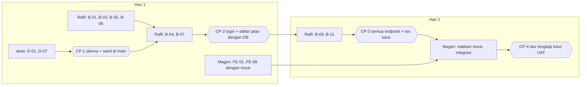

# Panduan Peran: Project Manager (tmthy)

> **Untuk tmthy.** Dokumen ini menjawab "apa yang harus disiapkan, kapan, dan bagaimana memastikan semuanya menyatu".
> Kamu pemilik `docs/`, `AGENTS.md`, `CLAUDE.md`, `README.md`, `Jenkinsfile`, dan `deploy/`. Kamu juga satu-satunya yang boleh mengubah [`../01-api-contract.md`](../01-api-contract.md).

## Ringkasan peran

| Hal | Isi |
| --- | --- |
| Tanggung jawab | Menyiapkan repo dan alat, membagi tugas, menjaga kontrak, meninjau PR, menguji alur lengkap, menyiapkan CI/CD (fase 2) |
| Kamu memberi ke semua | Repo GitHub, akses Figma, keputusan (tarif, perubahan kontrak), jadwal checkpoint |
| Kamu menerima dari | DB: skema + seed. Backend: API lulus tes. Frontend: halaman lulus cek F-xx |
| Prinsip | Kontrak dulu, kode kemudian. Kalau dua orang berbeda pendapat soal bentuk data, jawabannya ada di `01-api-contract.md`; kalau tidak ada, kamu yang memutuskan lalu memperbarui dokumen |

## Fase 0 · Persiapan sebelum Hari 1 (sekitar 1–2 jam)

### P-01 · Keputusan yang harus kamu ambil dulu

| Keputusan | Default di dokumen | Tindakan |
| --- | --- | --- |
| Tarif retribusi | `0.03` (contoh 3%) | Cari angka perda kabupaten/kota yang kalian jadikan konteks. Kalau tidak ketemu, biarkan 3% dan tulis sebagai asumsi di laporan |
| Nama TPI di topbar | "TPI Contoh" | Boleh diganti nama TPI nyata di Sulut, tapi konsisten di Figma dan frontend |
| Repo public atau private | — | Lihat P-03 soal branch protection |

### P-02 · Pastikan semua anggota punya alat

Kirim ke grup, minta tiap orang membalas hasil perintahnya:

```bash
git --version
go version        # 1.26 atau lebih baru  (wajib: Rafli, Magen [uji integrasi F-xx]; disarankan: semua)
node -v           # v22.23.4 atau lebih baru (syarat Astro 7) (wajib: Magen; disarankan: semua)
mysql --version   # MySQL 8.0.16+ / MariaDB 10.6+ (wajib: abas, Rafli, Magen; disarankan: semua)
```

### P-03 · Siapkan repo GitHub

1. Buat repo `sitangkap` (berisi README).
2. Salin seluruh isi paket dokumen ini ke root repo, lalu commit ke `main`:
   ```text
   AGENTS.md  CLAUDE.md  README.md  .gitignore  Jenkinsfile
   .github/  .githooks/  docs/  deploy/  backend/.env.example  db/.gitkeep
   ```
   Folder `frontend/` sengaja **tidak** dibuat dulu: `create-astro` (FE-01) menolak folder yang tidak kosong.
3. Undang Magen, Rafli, dan abas sebagai collaborator (Settings → Collaborators).
   Sebelum commit ini: jadikan hook bisa dieksekusi (`git update-index --chmod=+x .githooks/pre-push`). Ini satu-satunya commit langsung ke `main`.
   Setelah push, buat branch `dev` dari `main` dan push juga (`git switch -c dev && git push -u origin dev`), lalu jadikan `dev` default branch ([`../03-git-workflow.md`](../03-git-workflow.md) bagian 10.2–10.3).
4. Atur repo dan proteksi **`main` dan `dev`** persis seperti [`../03-git-workflow.md`](../03-git-workflow.md) bagian 10.1–10.4 (squash untuk PR tugas, merge commit untuk rilis, hapus branch tugas otomatis, `main` wajib PR + 1 approval, `dev` boleh push langsung, tidak bisa di-bypass admin). Lalu uji: push langsung ke `main` harus ditolak GitHub.
   **Catatan:** untuk repo *private*, protected branch butuh GitHub Pro di akun pemilik (gratis lewat GitHub Student Developer Pack); repo *public* bisa langsung.
5. Buat label: `frontend`, `backend`, `database`, `kontrak`, `bug`, `ci`.

### P-04 · Buat issue dari daftar ini

Satu issue per baris. Judul memakai ID supaya mudah dirujuk di commit dan PR (`feat(backend): B-07 login dan sesi (#12)`).

| Issue | Pemilik | Label | Bergantung pada |
| --- | --- | --- | --- |
| D-01–D-03 Skema dan user database | abas | database | — |
| D-04 Seed data demo | abas | database | D-02 |
| D-05 `queries.md` + DSN | abas | database | D-02 |
| D-06–D-07 Verifikasi + README database | abas | database | D-04 |
| B-01–B-03 Modul, config, respond | Rafli | backend | — |
| B-04 Store MySQL + memStore | Rafli | backend | D-05 |
| B-05–B-06 Hitung + validasi (dengan tes) | Rafli | backend | — |
| B-07 Login, logout, me, sesi | Rafli | backend | B-04 |
| B-08–B-09 Rute + handler transaksi, rekap, health | Rafli | backend | B-07 |
| B-10–B-11 Tes T-01..T-16 + uji integrasi | Rafli | backend | B-09 |
| FE-01–FE-02 Proyek Astro + token desain | Magen | frontend | — |
| FE-03–FE-05 Format, API, mock, guard | Magen | frontend | — |
| FE-06 Halaman login | Magen | frontend | FE-05 |
| FE-07 Halaman petugas | Magen | frontend | FE-05 |
| FE-08 Halaman dinas | Magen | frontend | FE-05 |
| FE-09–FE-10 Responsif + cek manual | Magen | frontend | FE-08, B-10 |
| CI-01..CI-06 Jenkins + webhook (fase 2) | tmthy | ci | Semua di atas |
| AI-01 Kontrak asisten chat (FR-012) | tmthy | kontrak | — |
| AI-02 Figma 30 panel "Tanya SiTangkap" | tmthy | frontend | AI-01 |
| B-13 Aturan chat + tes T-17..T-20 | tmthy (review Rafli) | backend | AI-01 |
| B-14 Handler `POST /api/chat` + tes T-21..T-22 | tmthy (review Rafli) | backend | B-13 |
| B-15 Percakapan ringan dan gaya + tes T-23..T-25 | tmthy (review Rafli) | backend | B-14 |
| FE-11 API + mock chat | tmthy (review Magen) | frontend | AI-01 |
| FE-12 Panel chat + cek F-14..F-17 | tmthy (review Magen) | frontend | FE-11, B-15, AI-02 |

Tugas chat (AI-01 s.d. FE-12) dikerjakan tmthy dengan pengecualian folder di `AGENTS.md` bagian 1. Nama branch tetap memakai peran folder yang diubah: `backend/tmthy-b13-aturan-chat`, `backend/tmthy-b14-handler-chat`, `backend/tmthy-b15-percakapan-chat`, `frontend/tmthy-fe11-api-chat`, `frontend/tmthy-fe12-panel-chat`.

### P-05 · Bagikan Figma dan kirim pesan pembuka

1. Di Figma, Share → undang email Magen (minimal "can view"; Magen butuh Dev Mode/inspect untuk melihat ukuran).
2. Kirim pesan pembuka ke grup: link repo, link Figma, urutan baca dokumen (`AGENTS.md` → `docs/00-overview.md` → `docs/03-git-workflow.md` → `docs/01-api-contract.md` → dokumen perannya), dan jadwal checkpoint di bawah.
3. Minta setiap anggota menjalankan bagian 2 di `docs/03-git-workflow.md` (identitas Git, clone, `git config core.hooksPath .githooks`) dan mengirim screenshot `git config core.hooksPath`.

## Jadwal 2 hari dan checkpoint



Di setiap checkpoint yang lulus, buat **PR rilis `dev` → `main`** dengan merge commit ([`../03-git-workflow.md`](../03-git-workflow.md) bagian 4). Di fase 2, rilis inilah yang memicu deploy Jenkins.

| Checkpoint | Kapan | Bukti yang kamu minta | Kalau terlambat |
| --- | --- | --- | --- |
| CP-1 | Hari 1, tengah hari | PR database digabung; `db/verify.sql` menghasilkan `5 / 370.75 / 11577000 / 347310` | Backend tetap lanjut dengan `memStore` dan tes; jangan diam menunggu |
| CP-2 | Hari 1, akhir hari | Curl login → me → GET transaksi berhasil terhadap MySQL lokal | Frontend tetap memakai mock; prioritaskan B-07 di pagi Hari 2 |
| CP-3 | Hari 2, tengah hari | `go test ./...` lulus T-01..T-16; semua curl di kontrak bagian 7 sesuai | Potong FR-010 (Should) bila perlu, bukan FR Must |
| CP-4 | Hari 2, akhir hari | UAT di bawah lulus dari repo yang baru di-clone | Catat yang belum lulus sebagai issue `bug`; demo memakai alur yang sudah lulus |

Rapat singkat 10 menit di awal dan akhir tiap hari: apa yang selesai, apa yang menghambat, apakah ada yang perlu mengubah kontrak.

## Meninjau pull request

Pakai daftar ini untuk setiap PR sebelum approve:

- [ ] Base PR adalah `dev` (PR tugas ke `main` ditutup dan dibuat ulang)
- [ ] Nama branch sesuai format `<peran>/<nama>-<id>-<ringkasan>`
- [ ] PR hanya mengubah folder milik pembuatnya
- [ ] Judul atau deskripsi menyebut ID tugas (D-xx, B-xx, FE-xx)
- [ ] Nama field, kode status, dan pesan error sama dengan `01-api-contract.md`
- [ ] Tidak ada rahasia: `.env`, password production, token
- [ ] Tidak ada dependensi baru di luar yang diizinkan (`go.mod`: 2 dependensi; frontend: hanya Astro)
- [ ] Pembuat PR menempelkan hasil verifikasi: `go test`, `npm run build`, atau `verify.sql`
- [ ] Untuk PR dari AI agent: kamu atau pemilik peran sudah membaca diff-nya, bukan hanya ringkasan agent

## UAT · Uji alur lengkap (CP-4)

Lakukan dari clone baru supaya ketahuan bila ada file yang lupa di-commit.

```bash
git clone https://github.com/tmthyjw23/SiTangkap.git sitangkap-uat && cd sitangkap-uat     # otomatis di branch dev (default branch)
mysql -u root -p < db/schema.sql
mysql -u root -p < db/app_user.sql
mysql -u root -p sitangkap < db/seed.sql
cp backend/.env.example backend/.env
(cd backend && go test ./... && go run .)      # terminal 1
(cd frontend && npm ci && npm run dev)         # terminal 2, buka http://localhost:4321
```

| No | Langkah | Harapan | Req |
| --- | --- | --- | --- |
| 1 | Login password salah | Pesan merah, tetap di login | FR-001 |
| 2 | Login `petugas01` | Halaman petugas, 8 transaksi | FR-001, FR-003 |
| 3 | Tambah transaksi, cek pratinjau | Pratinjau = angka setelah simpan | FR-004, FR-007 |
| 4 | Simpan dengan berat kosong | Pesan di bawah input | BR-02 |
| 5 | Ubah, lalu hapus transaksi tadi | Data berubah, lalu hilang setelah konfirmasi | FR-005, FR-006 |
| 6 | Keluar, login `dinas01` | Halaman dinas, rentang bulan ini | FR-002, FR-008 |
| 7 | Rentang 01/10/2026–22/10/2026 | `370,75 kg / Rp 11.577.000 / Rp 347.310 / 5` | FR-008, FR-009 |
| 8 | Tombol Tahun ini | Data Agustus–Oktober ikut terhitung | FR-010 |
| 9 | Sebagai dinas, buka `/petugas` | Dialihkan ke `/dinas` | BR-01 |
| 10 | `curl -b <cookie dinas> -X POST .../api/transaksi` | 403 | BR-01 |
| 11 | `cd frontend && npm run build`, isi `STATIC_DIR=../frontend/dist` di `backend/.env`, jalankan backend, buka `http://localhost:3000` | Halaman login tampil dari backend | Persiapan fase 2 |

## Memakai AI coding agent dengan aman (sampaikan ke tim)

1. **Satu sesi, satu tahap.** Beri agent satu ID (misal B-07), bukan "buat backend".
2. **Selalu mulai dari prompt di akhir dokumen peran.** Prompt itu memaksa agent membaca `AGENTS.md` dan kontrak lebih dulu.
3. **Agent bukan pengambil keputusan kontrak.** Kalau agent mengusulkan field atau endpoint baru, tolak dan bawa ke issue `kontrak`.
4. **Minta bukti, bukan klaim.** Agent harus menunjukkan output `go test`, `npm run build`, atau query verifikasi.
5. **Baca diff sebelum commit.** Perhatikan file di luar folder peran, dependensi baru, dan rahasia.
6. **Commit kecil.** Satu tahap = satu commit/PR, supaya mudah di-revert kalau agent merusak sesuatu.

## Risiko dan antisipasi

| Risiko | Tanda | Antisipasi |
| --- | --- | --- |
| Backend terlambat | CP-2 belum lulus | Frontend tetap jalan dengan mock; backend fokus Must dulu (login, CRUD, rekap) |
| Frontend dan backend beda bentuk data | Error saat integrasi | Kontrak + mock yang meniru kontrak; perbedaan = bug di pihak yang menyimpang |
| AI agent menambah library atau endpoint | Diff besar, `go.mod`/`package.json` berubah | Tolak PR; ulangi dengan prompt dari dokumen peran |
| Database berbeda versi | `CHECK` tidak jalan di MySQL lama | Wajib MySQL 8.0.16+ / MariaDB 10.6+ (P-02) |
| Waktu habis | Hari 2 sore belum CP-3 | Potong FR-010 (Should); jangan potong validasi dan cek peran |

## Fase 2 · CI/CD

Setelah CP-4, ikuti [`../02-cicd-jenkins.md`](../02-cicd-jenkins.md). Mulai siapkan VPS lebih awal (instalasi Jenkins memakan waktu), tapi **jangan** biarkan urusan server mengganggu jadwal development.

## Hubungan dengan materi System Analysis and Design

| Materi kuliah | Ada di |
| --- | --- |
| Requirement Gathering: stakeholder, FR/NFR, business rules, MoSCoW, RTM | `00-overview.md` bagian 2–9 |
| Teknik elisitasi | Document analysis (perbup, skripsi, jurnal) dan prototyping (Figma), `00-overview.md` bagian 2 |
| Use Case | `00-overview.md` bagian 8 |
| Activity / Sequence | Belum dibuat. Bahan: tabel langkah di `frontend-magen.md` FE-06..FE-08 dan alur handler di `backend-rafli.md` B-07, B-09 |
| Class Diagram | Struct dan interface `Store` di `backend-rafli.md` B-04, B-05 (domain: User, Transaksi; design: handler/service/repository) |
| ERD | `database-abas.md` D-02 |
